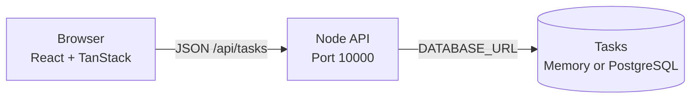

<div align="center">

# Focus Board

**A local-first task app built with TanStack, Node, and PostgreSQL.**

Start with a useful app. Add infrastructure when you are ready.

<p>
  <a href="https://tanstack.com/router/latest"></a>
  <a href="https://tanstack.com/query/latest"></a>
  <a href="https://nodejs.org/"></a>
  <a href="https://www.postgresql.org/"></a>
</p>

<p>
  <a href="#quickstart">Quickstart</a> ·
  <a href="#how-it-works">How it works</a> ·
  <a href="#api">API</a> ·
  <a href="#add-a-blueprint-later">Blueprint later</a>
</p>

</div>

> **Start here:** run the app locally, add a task, mark it complete, and see the frontend talk to the backend. This repository does not include a `render.yaml` file and does not deploy anything by itself.

## The app

Focus Board keeps one job visible: manage a short list of tasks.

| You can | What happens |
| --- | --- |
| Add a task | The browser sends a `POST` request to the Node API. |
| Complete a task | The API updates the task, then TanStack Query refreshes the list. |
| Filter the list | The browser shows all, open, or completed tasks. |
| Delete a task | The API removes it from the current storage. |

## Quickstart

### Requirements

- Node.js 20 or newer
- Git
- A terminal

You do not need PostgreSQL or a Render account to run the app locally.

### Run it

```bash
git clone https://github.com/ojusave/tanstack-render-atlas.git
cd tanstack-render-atlas
npm install
npm run dev
```

Open [http://127.0.0.1:5173](http://127.0.0.1:5173).

You should see:

- Two starter tasks
- An **API connected** status
- The **Add task** field
- Filters for **All**, **Open**, and **Done**

The single development command starts both parts of the app:

| URL | Part |
| --- | --- |
| `http://127.0.0.1:5173` | Vite frontend |
| `http://127.0.0.1:10000` | Node backend |

<details>
<summary>Expected terminal output</summary>

```text
DATABASE_URL is not set. Using the local in-memory store.
Focus Board listening on port 10000
VITE v6.4.4 ready
➜  Local: http://127.0.0.1:5173/
```

</details>

### Try the main flow

1. Enter a task in **What needs doing?**.
2. Select **Add task**.
3. Select the checkbox to mark it complete.
4. Select **Done** to see completed work.
5. Select **Delete** to remove the task.

Stop the local servers with `Ctrl+C` in the terminal running `npm run dev`.

## How it works



The browser uses TanStack Router for the page entry point and TanStack Query for server data. The Node backend serves the built frontend and handles task requests. The database layer chooses the storage mode at startup.

## API

The local backend listens on port `10000`.

| Method | Route | Purpose |
| --- | --- | --- |
| `GET` | `/api/health` | Reports backend and storage status |
| `GET` | `/api/tasks` | Returns the task list |
| `POST` | `/api/tasks` | Creates a task from `{ "title": "..." }` |
| `PATCH` | `/api/tasks/:id` | Updates completion from `{ "completed": true }` |
| `DELETE` | `/api/tasks/:id` | Deletes a task |

Check the backend directly:

```bash
curl http://127.0.0.1:10000/api/health
```

Expected local response:

```json
{"ok":true,"service":"focus-board","database":"memory"}
```

Create a task without using the browser:

```bash
curl -X POST http://127.0.0.1:10000/api/tasks \
  -H 'Content-Type: application/json' \
  -d '{"title":"Read the API response"}'
```

## Storage

| Mode | When it is used | What to expect |
| --- | --- | --- |
| Memory | `DATABASE_URL` is missing | The app starts immediately. Data resets when the backend restarts. |
| PostgreSQL | `DATABASE_URL` is set | The backend creates a `tasks` table and stores tasks persistently. |

The backend uses port `10000` by default. Set `PORT` to use a different port.

## Build and run the production shape

Build the TypeScript and frontend bundle:

```bash
npm run build
```

Run the built application:

```bash
npm run start
```

The Node server then serves the built frontend and API from port `10000`.

<details>
<summary>Successful build output</summary>

```text
✓ 170 modules transformed.
✓ built in 663ms
```

Build time varies by machine.

</details>

## Add a Blueprint later

The application comes first. When the local task flow is clear, add your own `render.yaml` file at the repository root.

The Blueprint should contain two resources:

| Resource | Configuration |
| --- | --- |
| Web service | Node runtime, `npm ci && npm run build`, `npm start`, and `/api/health` as the health check |
| PostgreSQL | A managed database connected to the web service through `DATABASE_URL` |

The expected shape is:

<details>
<summary>Blueprint preview</summary>

```yaml
services:
  - type: web
    name: focus-board
    runtime: node
    region: oregon
    plan: starter
    buildCommand: npm ci && npm run build
    startCommand: npm start
    healthCheckPath: /api/health
    envVars:
      - key: NODE_ENV
        value: production
      - key: DATABASE_URL
        fromDatabase:
          name: focus-board-db
          property: connectionString

databases:
  - name: focus-board-db
    region: oregon
    plan: basic-256mb
    databaseName: focus_board
    user: focus_board
```

</details>

Review the Blueprint before applying it in Render. Running this repository locally does not create or change Render resources. See Render’s [Blueprint YAML reference](https://render.com/docs/blueprint-spec) for the current schema.

## Project map

| Path | Role |
| --- | --- |
| [`src/main.tsx`](src/main.tsx) | Starts TanStack Router and TanStack Query. |
| [`src/routes.tsx`](src/routes.tsx) | Defines the task screen and user interactions. |
| [`src/hooks/useBackend.ts`](src/hooks/useBackend.ts) | Connects the UI to the backend with TanStack Query. |
| [`src/lib/api.ts`](src/lib/api.ts) | Defines browser API requests and response types. |
| [`scripts/dev.mjs`](scripts/dev.mjs) | Starts the frontend and backend together. |
| [`scripts/server.mjs`](scripts/server.mjs) | Serves the frontend and handles API requests. |
| [`scripts/db.mjs`](scripts/db.mjs) | Chooses memory or PostgreSQL storage. |

## Troubleshooting

<details>
<summary>Port 10000 or 5173 is already in use</summary>

Stop the other local development process, then run `npm run dev` again. The backend uses port `10000` and Vite uses port `5173` by default.

</details>

<details>
<summary>The page says the API is offline</summary>

Keep the terminal running `npm run dev` open. The frontend calls the Node backend at `http://127.0.0.1:10000`. Check the first error in that terminal, then refresh the browser after the backend starts.

</details>

<details>
<summary>Tasks disappear after a restart</summary>

That is expected when `DATABASE_URL` is not set. The local memory fallback keeps setup simple. Configure PostgreSQL when you need persistent data.

</details>

## License

No license has been selected for this repository yet.
